# NotePad 架构与设计细节

> 版本：v1.0
> 状态：与《文件化改造方案（v2.1）》口径一致
> 日期：2026-10-31
> 关联文档：[refactor-plan.md](./refactor-plan.md) · [product.md](./product.md)
> 代码基线：文件 vault 为默认后端（`lib/data/vault/`），sqlite 实现（`lib/data/sqlite_notes_repository.dart`）作为 `storage.backend=sqlite` 的回退保留；实现状态见 [refactor-plan.md](./refactor-plan.md) 第 10 节

---

## 1. 设计原则

| # | 原则 | 落地方式 |
|---|---|---|
| P1 | 正文只有文件一份 | 文章 = `.md` 文件；无正文数据库；索引 / 缓存可删除重建 |
| P2 | UI 与存储解耦 | 页面只依赖 `NotesRepository`；sqlite / 文件实现共用同一契约 |
| P3 | 能力自闭环 | 每个能力一个命名空间根；回收站、索引、备份均在 `<nsRoot>/.notepad/` 或 `<appDataRoot>/namespaces/<nsId>/` 内 |
| P4 | 机制归宿主，策略归能力 | 搬运 / 打包 / 校验 / 原子落盘由宿主实现；能力只声明排除项、钩子、元数据 |
| P5 | 数据格式可救援 | 备份容器、trash manifest、注册表由宿主定义（D12）；插件停用后仍可解读 |
| P6 | 声明式插件 | 无第三方动态代码；能力实现随宿主分发，manifest 只声明与资源（D8） |
| P7 | 可回滚改造 | Repository 接缝 + 双实现灰度；backend 开关可切回 sqlite（D10） |

**明确不做**（D1）：跨设备实时同步、冲突自动合并、跨命名空间原子恢复、插件自定义不透明格式。

---

## 2. 分层架构

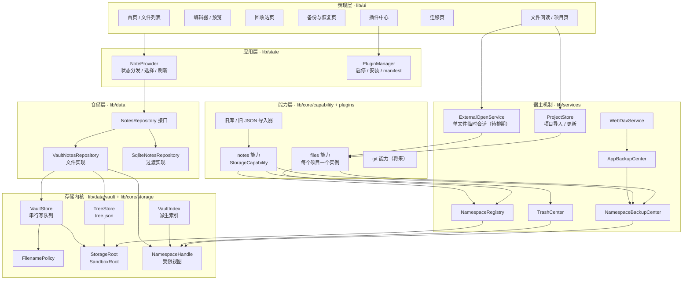

### 2.1 依赖规则

- `ui` **不得**直接 import `dart:io`、`NoteDao`、`AppDatabase`；只能经 `NoteProvider` → `NotesRepository`。
- `data/vault` 不依赖 `services`；`services` 可依赖 `core/storage` 与 `data/vault`；反向禁止。
- `core/storage` 只定义契约与受限视图，不含具体插件逻辑。
- 能力实现可以依赖 `TrashCenter` / `NamespaceBackupCenter` 的**接口**，不得自行实现搬运与打包。

- `workbench` 不得被 `plugins/` 依赖；插件 manifest 的 `contributes` 只作为数据保存，由 `workbench/` 解析（见 [workbench.md](./workbench.md)）。
- 工作台里的能力实现（`workbench/extensions`）只能经 `FileSystemProvider` 向外暴露数据；`ui` 与 `services` 不得依赖具体能力。

### 2.2 模块职责

| 模块 | 职责 | 关键约束 |
|---|---|---|
| `NoteProvider` | 当前层级、选中、多选、搜索、回收站缓存、刷新 | 不持有文件句柄；写操作串行调用 repository |
| `NotesRepository` | 对外唯一数据接口 | 列表不带 body；写操作幂等语义清晰 |
| `VaultStore` | 原子写、移动、删除、目录创建 | 内部串行队列；同目录 tmp + rename |
| `TreeStore` | `tree.json` 读写、顺序、时间戳、标签 | 单次写全量替换，失败保留旧文件 |
| `FilenamePolicy` | 清洗、NFC、截断、重名、保留名 | 唯一跨端命名真相 |
| `VaultIndex` | 路径 / 标题 / mtime / size 派生索引 | 可删可重建，不存用户意图 |
| `StorageRoot` | 路径抽象（沙盒 / 未来 SAF） | 只接受相对路径，禁止 `..` 越界 |
| `NamespaceHandle` | 限定在单一 nsRoot 的受限视图 | 越界必须抛错；能力拿不到裸路径 |
| `NamespaceRegistry` | 命名空间注册、状态、驱动开关 | 权威文件在 vault 内，随备份迁移 |
| `TrashCenter` | 子树搬运、manifest、恢复、清空、聚合 | 只有宿主可搬运；能力只提供策略 |
| `NamespaceBackupCenter` | 单命名空间 zip 快照 / 恢复 | 容器格式固定；sha256 校验 |
| `AppBackupCenter` | 整机包、逐命名空间恢复、journal | 不宣称跨命名空间原子 |
| `PluginManager` | 安装、启停、卸载语义 | 卸载 = 停用并保留数据；内置插件通过 `uninstallable` 声明可卸载（仅停用，不删包） |
| `ExternalOpenService` | 接收系统外部打开请求；解析 URI / 临时文件；管理只读会话 | 待排期；当前仅支持应用内文件选择器 |
| `ProjectStore` | 扫描源目录、预览、拷贝到 staging、注册项目命名空间 | 只拷贝，不改源目录；跳过符号链接；失败清理 staging |
| `FilesCapability` | 文件阅读能力的 `StorageCapability` 实现 | 每个项目一个实例；`TrashPolicy = null`；备份按项目命名空间 |
| `Workbench` | 标签 / 活动编辑器 / 侧栏 / 工作区文件夹 / 会话 / 命令执行入口 | 不依赖具体能力；执行未注册命令先触发 `onCommand` 激活 |
| `ExtensionHost` | 按插件启停同步贡献、按激活事件懒激活、停用即释放 | 激活失败隔离并记录，不拖垮宿主；注册全部可回收 |
| `FileSystemRegistry` / `FileSystemProvider` | 命名空间的统一资源视图（`notes`、`files.<id>`） | 默认只读；写操作需 provider 显式实现 |
| `ContributionRegistry` | 汇总插件 `contributes`（命令 / 菜单 / 视图 / 编辑器 / 状态栏） | 随插件启停整体增删；坏条目被跳过 |

---

## 3. 磁盘布局与命名空间

### 3.1 布局

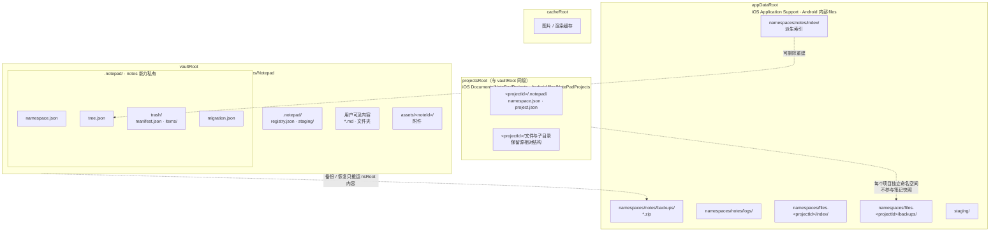

### 3.2 角色与平台映射

| 角色 | iOS | Android | 说明 |
|---|---|---|---|
| `vaultRoot` | 沙盒 `Documents/Notepad` | 应用内部 `files/Notepad` | 用户数据根；随系统设备备份 |
| `projectsRoot` | 沙盒 `Documents/NotePadProjects` | 应用内部 `files/NotePadProjects` | 文件阅读项目根；与笔记库同级隔离 |
| `appDataRoot` | `Library/Application Support/Notepad` | path_provider 应用支持目录 | 索引、快照、日志、staging |
| `cacheRoot` | `Library/Caches` | 应用缓存目录 | 可随时清理 |

- `appDataRoot` 统一由 `getApplicationSupportDirectory()` 获取，不依赖平台特称。
- `nsRoot` 对 notes 等于 `vaultRoot`；对 `files.<projectId>` 等于 `projectsRoot/<projectId>`，在注册表中记录绝对路径。
- `Caches` 不放任何用户意图数据。

### 3.3 固定保留名

`.notepad`、`assets`、以 `.` 开头的名称均为系统保留，用户不可创建。

### 3.4 项目根与笔记库隔离

- 文件阅读项目放在 `projectsRoot/<projectId>/`，**不放在 `vaultRoot` 内**：notes 的 `nsRoot == vaultRoot`，若项目放进 vault 会被笔记列表扫描到，并被笔记快照重复打包。
- `projectsRoot` 作为独立的 `SandboxRoot` 基目录；项目 `NamespaceHandle` 以 `<projectsRoot>/<projectId>` 为根，仍然只能使用相对路径，注册表里的绝对路径只用于定位基目录。
- 每个项目根内有且仅有 `.notepad/namespace.json`、`.notepad/project.json`；不写 `tree.json`（只读浏览按文件名自然排序或索引顺序）。
- 项目索引与快照放 `appDataRoot/namespaces/files.<projectId>/`，与 notes 平级隔离。
- 项目根不可用时注册表 `state=missing`，不阻塞笔记命名空间启动。

---

## 4. 数据模型与 Schema

### 4.1 tree.json（元数据权威）

```json
{
  "schema": 1,
  "updatedAt": 1761800000000,
  "nodes": [
    {
      "id": "note-01",
      "kind": "note",
      "path": "工作/周报.md",
      "order": 0,
      "createdAt": 1710000000000,
      "updatedAt": 1761800000000,
      "tags": [],
      "favorite": false
    },
    {
      "id": "folder-01",
      "kind": "folder",
      "path": "工作",
      "order": 1,
      "createdAt": 1710000000000
    }
  ]
}
```

| 字段 | 类型 | 约束 |
|---|---|---|
| `schema` | int | 固定 1；升级需迁移器 |
| `nodes[].id` | string | 稳定不变；文件重命名不换 id |
| `nodes[].kind` | `note` / `folder` | 与磁盘类型一致 |
| `nodes[].path` | string | 相对 `nsRoot`，NFC 归一化 |
| `nodes[].order` | int | 仅同一父目录内比较 |
| `nodes[].createdAt` / `updatedAt` | int（ms） | 磁盘 mtime 与 tree 不一致时以「较新」为准并校正 |
| `tags` / `favorite` | array / bool | 可选扩展，本期不做 UI |

**对账规则**

| 情况 | 处理 |
|---|---|
| 磁盘有、tree 无 | 生成新 id 入 tree，顺序追加到末尾 |
| tree 有、磁盘无 | 标记 `missing`（内存态），UI 灰态，可从 tree 丢弃 |
| 外部改名 | 视为「删 + 增」，不追踪内容指纹（v2 已知限制） |
| tree 丢失 / 损坏 | 全盘扫描重建；顺序按文件名自然排序；`migration.json` 记录 `rebuilt: true` |
| 写 tree 失败 | 保留旧 tree 文件，本次操作返回失败，UI 提示重试 |

### 4.2 registry.json（命名空间注册表，D6）

```json
{
  "schema": 1,
  "namespaces": [
    {
      "id": "notes",
      "pluginId": "builtin.notes",
      "root": "",
      "displayName": "笔记",
      "schema": 1,
      "state": "active",
      "drivers": { "backup": true, "trash": true },
      "createdAt": 1761800000000
    },
    {
      "id": "files.p-01",
      "pluginId": "builtin.files",
      "root": "/data/.../Documents/NotePadProjects/p-01",
      "displayName": "flutter-app",
      "schema": 1,
      "state": "active",
      "drivers": { "backup": true, "trash": false },
      "createdAt": 1761800500000
    }
  ]
}
```

| 字段 | 说明 |
|---|---|
| `root` | 空 = 根即 `vaultRoot`；绝对路径 / URI = 外部根（文件阅读项目使用绝对路径） |
| `state` | `active` / `disabled` / `missing` |
| `drivers` | 该能力**是否提供**备份 / 回收站驱动（能力属性，不随停用变化）；缺失则 UI 隐藏或警告。文件阅读项目 `trash=false` |
| 多命名空间同插件 | 允许；`files.<projectId>` 均属 `builtin.files`，停用插件时统一置 `disabled` |

生命周期：`register` → `resolve` → `deactivate(pluginId)` → `activate(pluginId)` → `forget(namespaceId)`。
**卸载 = `deactivate`**，不 `forget`；`forget` 前必须 trash 为空 + 二次确认。

### 4.3 namespace.json（能力自描述 marker）

```json
{ "schema": 1, "namespaceId": "notes", "pluginId": "builtin.notes", "createdAt": 1761800000000 }
```

用途：命名空间根被单独拷贝 / 恢复后，宿主仍能识别归属。

### 4.4 trash/manifest.json（宿主定义，D12）

```json
{
  "schema": 1,
  "entries": [
    {
      "id": "note-01",
      "kind": "note",
      "originalPath": "工作/周报.md",
      "trashPath": "items/note-01/周报.md",
      "deletedAt": 1761800000000,
      "metadata": { "title": "周报" }
    }
  ]
}
```

| 规则 | 说明 |
|---|---|
| `items/<id>/` | 保留原相对结构，文件夹整棵子树一个条目 |
| `metadata` | 能力通过 `TrashPolicy.metadataFor` 补充，宿主原样存取 |
| id 冲突 | 复用原节点 id；同一节点重复删除不会产生重复条目 |
| manifest 损坏 | 宿主重建：扫描 `items/` 并按目录名兜底，原路径标记为「未知」 |

### 4.5 备份容器（宿主定义）

单命名空间：

```
notes-20261031-120000.zip
├─ manifest.json
└─ data/                    # nsRoot 内容，按排除项裁剪
```

```json
{
  "schema": 1,
  "kind": "namespace-backup",
  "namespaceId": "notes",
  "namespaceSchema": 1,
  "pluginVersion": "1.0.0",
  "appVersion": "1.0.0",
  "createdAt": 1761800000000,
  "excluded": ["index", "backups", "logs", "trash/items/*/tmp"],
  "files": [
    { "path": "工作/周报.md", "size": 123, "sha256": "..." }
  ]
}
```

整机：

```json
{
  "schema": 1,
  "kind": "app-backup",
  "appVersion": "1.0.0",
  "createdAt": 1761800000000,
  "namespaces": [
    { "id": "notes", "archive": "namespaces/notes.zip", "schema": 1 }
  ]
}
```

### 4.6 索引（派生，D7）

```json
{
  "schema": 1,
  "builtAt": 1761800000000,
  "rootMtime": 1761800000000,
  "entries": [
    { "id": "note-01", "path": "工作/周报.md", "title": "周报", "mtime": 1761800000000, "size": 123 }
  ]
}
```

- 索引仅用于搜索 / 最近 / 统计的加速；启动与对账时按 mtime 失效重建。
- 索引损坏或删除不影响数据，恢复流程结束后由 `afterRestore` 重建。

### 4.7 migration.json

```json
{
  "schema": 1,
  "source": "app_database.db",
  "sourceHash": "sha256:...",
  "startedAt": 1761800000000,
  "finishedAt": 1761800100000,
  "nodeCount": 1024,
  "trashCount": 12,
  "rebuilt": false,
  "result": "success"
}
```

### 4.8 project.json（文件阅读项目）

```json
{
  "schema": 1,
  "projectId": "p-01",
  "displayName": "flutter-app",
  "mode": "copy",
  "source": {
    "kind": "directory",
    "displayPath": "/Download/flutter-app",
    "sourceHash": "sha256:..."
  },
  "importedAt": 1761800500000,
  "updatedAt": 1761800500000,
  "fileCount": 120,
  "totalBytes": 3456789,
  "skipped": { "symlinks": 2, "unsupported": 0, "oversize": 0 }
}
```

| 字段 | 说明 |
|---|---|
| `mode` | 本期固定 `copy`；`reference` 预留给外部根（SAF / 安全书签） |
| `source.displayPath` | 仅用于 UI 展示与用户识别；**不得**用于后续访问 |
| `source.sourceHash` | 重复导入判定依据（规范化源路径 + 文件清单摘要），不匹配则视为新项目 |
| `skipped` | 导入时跳过项计数，UI 汇总提示 |
| 存储位置 | `<projectsRoot>/<projectId>/.notepad/project.json` |

**单文件会话（不落盘）**

外部打开的单文件不生成任何持久文件；会话对象只存在于内存，关闭即释放：

```dart
class OpenedFileSession {
  final String displayName;
  final String mime;
  final int size;
  final bool readOnly;      // 本期固定 true
  Future<String> readText({int maxBytes = 5 * 1024 * 1024});
  Future<void> saveAsNote(String title);
  Future<void> dispose();
}
```

- 不写注册表、不写 tree、不进入备份 / 回收站。
- 内容可缓存在 `cacheRoot` 以支持滚动 / 重渲染，退出即失效。
- `saveAsNote` 是唯一写入笔记库的动作，需用户显式触发。

---

## 5. 接口契约

### 5.1 StorageRoot / NamespaceHandle

```dart
abstract class StorageRoot {
  Future<bool> exists(String rel);
  Future<List<StorageEntry>> list(String relDir);
  Future<String> readText(String rel);
  Future<void> writeTextAtomic(String rel, String text);
  Future<void> writeBytesAtomic(String rel, List<int> bytes);
  Future<void> rename(String fromRel, String toRel);
  Future<void> delete(String rel);
  Future<DateTime> modifiedAt(String rel);
  bool get supportsWatch;
}
```

```dart
abstract class NamespaceHandle {
  String get namespaceId;
  Future<List<StorageEntry>> list(String relDir);
  Future<String> readText(String rel);
  Future<void> writeTextAtomic(String rel, String text);
  Future<void> rename(String fromRel, String toRel);
  Future<void> delete(String rel);
}
```

**硬约束**

- 所有相对路径必须通过 `_validate(rel)`：拒绝绝对路径、`..`、盘符、空路径、保留名越界。
- `NamespaceHandle` 内部把 `rel` 拼到 `nsRoot`，能力代码无法突破命名空间边界。
- `rename` 仅允许同根内；跨命名空间移动由上层「导出 + 导入」实现，禁止直接搬目录。
- v2 只实现 `SandboxRoot`；`SafRoot` 预留（Android 外部树）。
- `projectsRoot` 使用独立 `SandboxRoot` 实例，项目 handle 的根为 `<projectsRoot>/<projectId>`；`root` 字段只记录基目录定位信息，能力仍只拿 handle。

### 5.2 StorageCapability / 策略

```dart
abstract class StorageCapability {
  String get namespaceId;
  String get pluginId;
  NamespaceDescriptor get descriptor;
  BackupPolicy? get backupPolicy;   // null = 不参与备份
  TrashPolicy? get trashPolicy;     // null = 删除不可恢复
}

abstract class BackupPolicy {
  List<String> get excludePatterns;
  Future<void> quiesce();
  Future<void> resume();
  Future<void> afterRestore();
  Future<LegacyImportResult> importLegacy(LegacySource source);
}

abstract class TrashPolicy {
  bool get enabled;
  Future<Map<String, Object?>> metadataFor(String relativePath);
  Future<void> afterRestore(List<TrashEntry> entries);
}
```

| 场景 | 宿主行为 |
|---|---|
| `backupPolicy == null` | 备份页不显示该命名空间入口；整机备份跳过并记录原因 |
| `trashPolicy == null` 或 `enabled == false` | 删除前二次确认且文案标注「不可恢复」；不创建 trash 目录 |
| 策略抛异常 | 整体操作失败并回滚；错误分类为 `E-POLICY`，保留现场日志 |
| `excludePatterns` 为空 | 仍应用宿主固定排除项（`tmp`、`staging`、`backups`、`logs`） |

### 5.3 NotesRepository

```dart
abstract class NotesRepository {
  Future<void> init();
  Future<List<NotePadNode>> childrenOf(String? folderId);
  Future<NotePadNode?> nodeById(String id);
  Future<String> readBody(String id);
  Future<void> writeBody(String id, String body);
  Future<NotePadNode> createNode({required bool isFolder, required String title});
  Future<void> rename(String id, String newTitle);
  Future<void> move(List<String> ids, String? targetFolderId);
  Future<void> reorder(String? folderId, List<String> orderedIds);
  Future<void> moveToTrash(List<String> ids);
  Future<List<ScopedTrashEntry>> listTrash();
  Future<void> restore(List<String> ids);
  Future<void> purge(List<String> ids);
  Future<List<NotePadNode>> search(String keyword);
  Future<List<NotePadNode>> recent({int limit});
  Future<NoteStatistics> statistics();
  Future<void> replaceAll(List<NotePadNode> nodes, {String? stagingDir});
}
```

**行为约定**

| 方法 | 约定 |
|---|---|
| `childrenOf` | 只读单层目录 + tree 顺序；不加载正文 |
| `readBody` | 读文件；文件缺失返回 `E-NOT-FOUND`，由 UI 提示重建 / 丢弃 |
| `writeBody` | 原子写；更新 `updatedAt` 与 tree；失败向上抛出 |
| `createNode` | 同名自动加 ` (2)`；返回实际标题 |
| `rename` | 标题即文件名（D3）；冲突自动加后缀并返回实际名称 |
| `move` | 目录内移动；目标为自身或后代 → `E-CYCLE` |
| `reorder` | 只接受同一父目录的完整子集；缺失 id 视为 `E-VALIDATE` |
| `moveToTrash` | 走 `TrashCenter`；递归子树一个条目 |
| `restore` | 原路径占用则加后缀；父目录缺失自动重建 |
| `purge` | 物理删除；不可恢复，需 UI 二次确认 |
| `search` | 标题优先走索引，正文按需读；结果去重并带路径 |
| `statistics` | 走索引统计；索引缺失时触发一次重建 |
| `replaceAll` | 迁移 / 旧备份导入专用；先写 staging，成功后再切换 |

### 5.4 注册表接口

```dart
abstract class NamespaceRegistry {
  Future<void> load();
  Future<void> register(NamespaceDescriptor descriptor);
  Future<NamespaceDescriptor?> resolve(String namespaceId);
  Future<List<NamespaceDescriptor>> all();
  Future<void> deactivate(String pluginId);
  Future<void> activate(String pluginId);
  Future<void> forget(String namespaceId);
}
```

`deactivate` 只改 `state`，不动 `drivers` 与数据；`activate` 恢复 `active` 并按能力默认值校正 `drivers`（`files.*` 恒不提供回收站）。
`forget` 移除记录，回收站非空（manifest 条目或 `items/` 子项）时抛 `E-CONFLICT` 并保留记录；二次确认由 UI 负责。
`syncPluginStates` 在启动时把插件启停状态对齐到注册表，保证重启后内置插件的停用态不丢失。

### 5.5 ExternalOpenService（单文件外部调用）

> 状态：待排期。当前实现只覆盖应用内文件选择器（`ProjectStore.readExternalFile`），
> 系统 `ACTION_VIEW` / `ACTION_SEND`、`content://` 与 iOS 安全书签尚未接入。

```dart
abstract class ExternalOpenService {
  /// 处理冷启动挂起的打开请求（必须在首帧前完成解析，避免丢请求）。
  Future<void> init();

  /// 热启动 / 分享进入的请求流。
  Stream<OpenRequest> get requests;

  /// 读取并生成只读会话；能力未启用时抛出 E-POLICY。
  Future<OpenedFileSession> open(OpenRequest request);
}

class OpenRequest {
  final Uri uri;              // content:// / file:// / 安全书签
  final String? mime;
  final OpenSource source;    // view / share / picker
}
```

**约束**

- 平台通道负责把 `content://` / 安全书签解析为可读字节流；Dart 侧不假设真实文件路径。
- 打开前检查 `builtin.files` 是否启用；未启用时返回可恢复错误，由 UI 引导启用。
- 不写注册表、不写 tree、不写笔记库；`saveAsNote` 是唯一落库动作。
- 单文件会话持有临时句柄，`dispose` 必须释放安全书签 / 流；进程退出丢失会话是预期行为。

### 5.6 ProjectStore（项目维度导入）

> 实现位于 `lib/services/project_store.dart`，本期为拷贝模式（源目录不变）。

```dart
abstract class ProjectImporter {
  Future<ImportPreview> scan(ExternalDirectory source);
  Future<ProjectSummary> importProject(ImportPreview preview, {String? displayName});
  Future<ProjectSummary> updateProject(String projectId, ExternalDirectory source);
  Future<void> removeProject(String projectId, {bool snapshotFirst = true});
}

class ImportPreview {
  final String displayName;
  final int fileCount;
  final int totalBytes;
  final Map<String, int> skipped;     // symlinks / oversize / unsupported
  final String? duplicateProjectId;   // 同 sourceHash 命中时给出
}
```

**流程约束**

- `scan` 只读源目录，不复制；给出文件数、体积、跳过项与重复命中。
- `importProject` 先复制到 `<projectsRoot>/.staging/<ts>/`，完成后 rename 为 `<projectsRoot>/<projectId>/`，再注册命名空间；失败清理 staging。
- **目录名 = projectId，不可变**；显示名只存 `project.json`，改名不改目录，避免注册表与路径漂移。
- `updateProject` 采用「staging 复制 → 可选快照旧目录 → 原子替换 → 重建索引」，与快照恢复同一套安全机制。
- `removeProject` 若 `snapshotFirst` 且备份可用，先打快照再删除目录并 `forget`；否则二次确认后直接删除（不可恢复）。

**文件阅读能力的策略**

```dart
class FilesProjectCapability implements StorageCapability {
  final ProjectSummary project;

  @override
  String get namespaceId => 'files.${project.id}';

  @override
  String get pluginId => 'builtin.files';

  @override
  BackupPolicy get backupPolicy => FilesBackupPolicy(project); // 排除项为空 + 宿主固定排除项

  @override
  TrashPolicy? get trashPolicy => null; // 只读浏览，不提供文件级删除
}
```

- 备份：每个项目独立快照，`quiesce` / `resume` 为空操作，`afterRestore` 重建项目索引。
- 回收站：不提供；删除项目是命名空间级操作，走「快照 + 删除 + forget」而非文件搬运。

---

## 6. 关键流程

### 6.1 打开与编辑保存

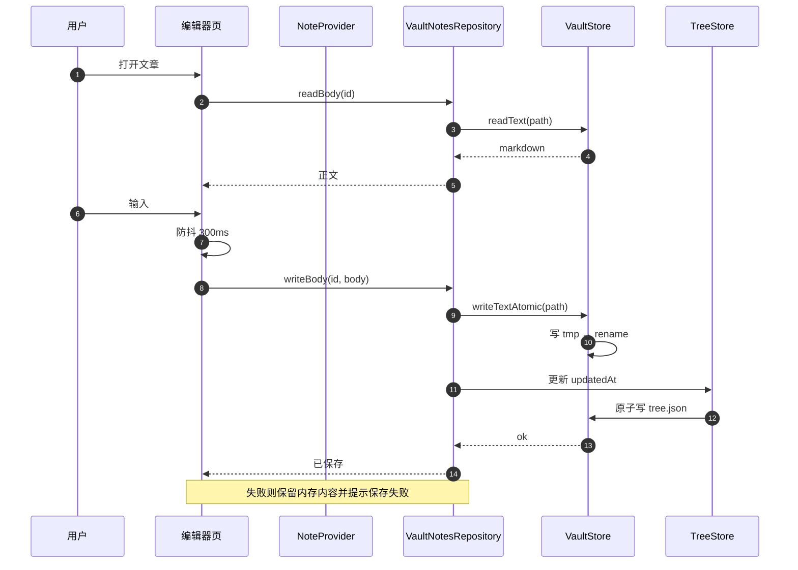

**设计细节**

- 防抖窗口内多次输入只触发一次写；退出编辑器强制 flush。
- 原子写：`.<name>.tmp` → `flush` → `rename`；启动时清理超过 24h 的残留 tmp。
- 写失败（磁盘满 / 权限）→ 不更新 tree，不显示「已保存」；提供「另存为」兜底。
- 外部 mtime 变化检测：写入前比较 mtime，若与打开时不同 → 提示用户选择，防静默覆盖。

### 6.2 删除到回收站

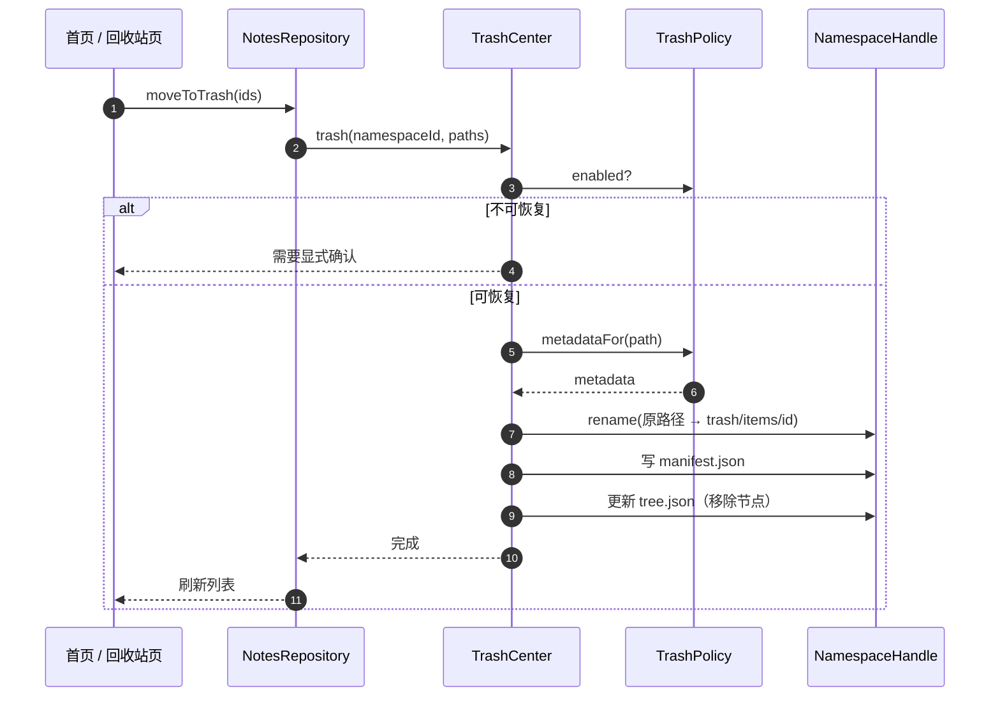

- 文件夹整棵子树只产生一个 trash 条目；`items/<id>/` 内保留原相对结构。
- 搬运失败（跨卷 / 权限）→ 回滚已移动的文件，manifest 不落盘。
- 恢复：先建父目录，再 rename；目标存在则加 ` (2)`；随后 `TrashPolicy.afterRestore` 重建索引。
- 清空：按命名空间逐个删除 `items/` 下内容，最后重写 manifest。

### 6.3 单命名空间备份

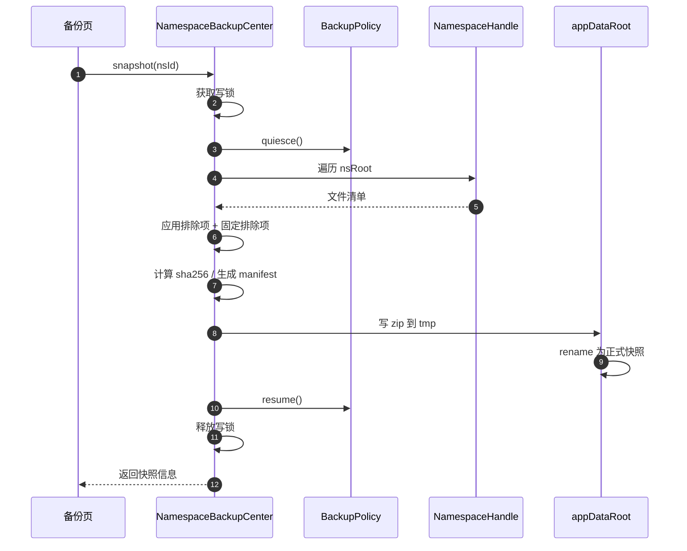

- 快照过程持有写锁：期间编辑请求排队，不丢输入。
- 打包先写 `<appDataRoot>/staging/`，成功后 rename 到 `backups/`，避免半包。
- `resume()` 必须在 `finally` 中执行，保证异常也能恢复后台任务。
- 保留策略由宿主统一执行（数值待产品确认，见 product.md Q1）。

### 6.4 恢复快照

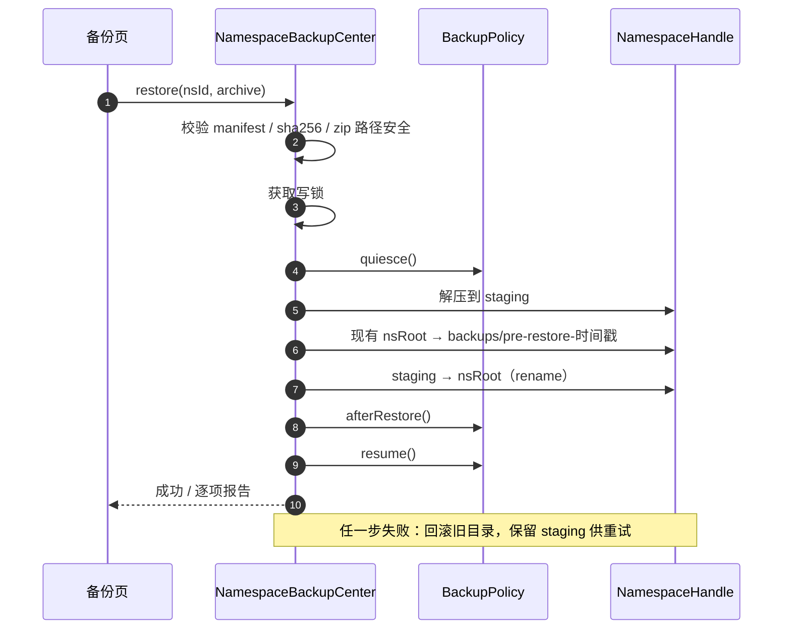

- 恢复是「替换命名空间内容」，不是合并；旧内容保留一份（份数待确认）。
- 不承诺跨命名空间原子；整机恢复按顺序执行并写 journal。
- 校验失败（hash / manifest schema / zip 越界）→ 立即拒绝，不触碰现有数据。

### 6.5 插件停用 / 重装

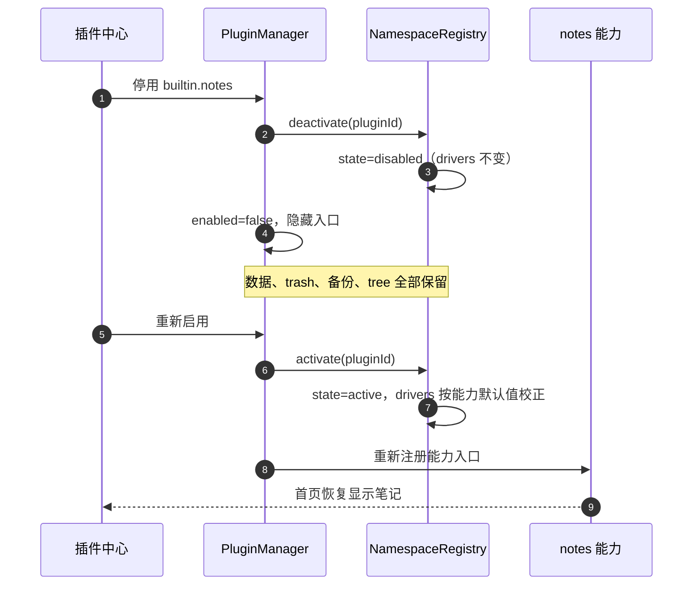

- 卸载外部插件 = 停用 + 删除插件包目录，**不**动命名空间数据。
- 重装 = 重新解包 + `activate`；若命名空间已存在则复用，不覆盖数据。

### 6.6 旧库迁移

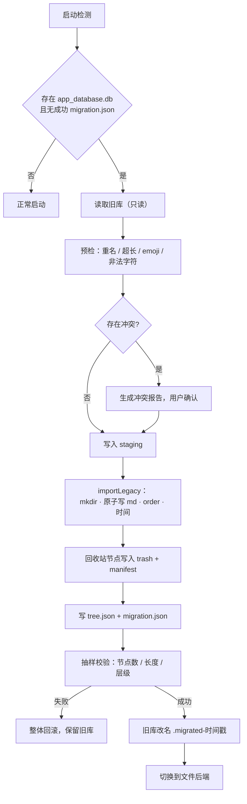

**幂等性**：迁移记录包含 `sourceHash`，相同来源重复执行直接跳过；`staging/<ts>/` 合并前先比对节点 id。

**回滚**：设置 `storage.backend=sqlite`，删除 `migration.json`，把 `.migrated-*` 改回 `.db`；`SqliteNotesRepository` 保留至下一个大版本。

### 6.7 外部调用打开单个文件

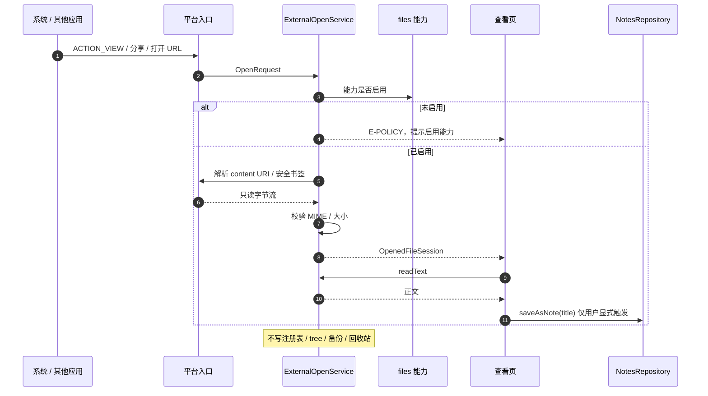

- 冷启动与热启动都必须能接到请求：冷启动在首帧前读取 pending 请求，热启动走请求流。
- 二进制、超大文件在会话创建阶段拒绝，避免整文件读入内存。
- 关闭查看页即 `dispose`；不提供「最近打开外部文件」持久列表。

### 6.8 按项目维度导入

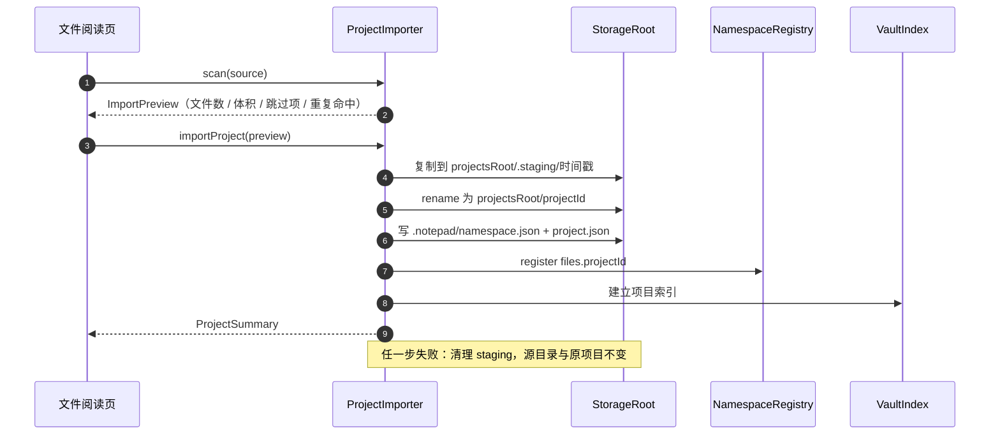

---

## 7. 插件生命周期状态机

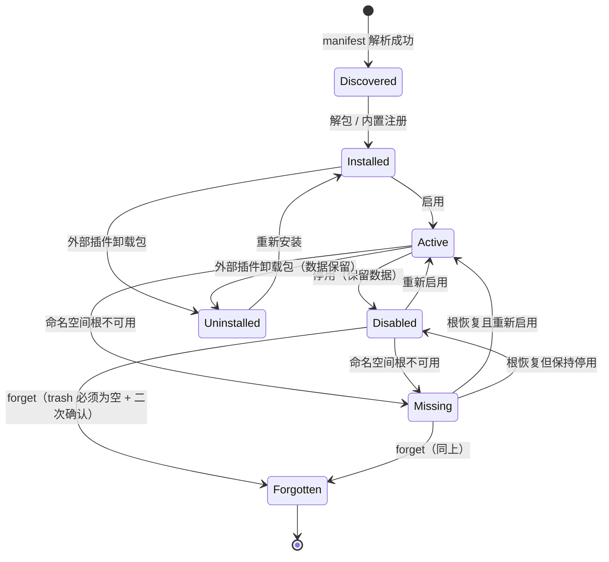

| 状态 | 数据 | 入口 | 备份 / 回收站 |
|---|---|---|---|
| `Active` | 保留 | 显示 | 可用 |
| `Disabled` | 保留 | 隐藏 | 可用（带「已停用」标签） |
| `Missing` | 可能在外部根 | 隐藏 | 灰态，提示根不可用 |
| `Forgotten` | 已被用户显式移除记录 | 无 | 不再出现 |
| `Uninstalled` | 命名空间保留 | 无 | 仍可操作数据（D12） |

---

## 8. 并发、原子性与崩溃恢复

### 8.1 写模型

- **单写队列**：`VaultStore` 内部串行执行所有变更操作（创建 / 改名 / 移动 / 删除 / 写正文 / 写 tree）。
- **读写分离**：列表与读取可并发；写操作不与读操作交错破坏结构（读取到旧快照可接受）。
- **写锁**：备份 / 恢复使用跨操作的全局写锁；期间用户写入排队，`quiesce` 保证内存态已 flush。
- **tree 单写**：同一时刻只有一个 writer 持有 tree；写前校验 mtime，冲突则重读合并后重试一次。

### 8.2 原子写

```
write(path):
  tmp = dir/.<name>.<pid>.<ts>.tmp
  writeAll(tmp, bytes); flush; close
  rename(tmp, path)            # 同目录，原子替换
  fsync(dir)                   # 可选，平台支持时
```

- iOS / Android 同一文件系统内 rename 原子；跨卷移动不允许直接 rename，需「复制 + 校验 + 删除」。
- 启动清理：删除超过 24h 的 `*.tmp`；staging 中未完成恢复的目录保留并提示用户。

### 8.3 崩溃恢复矩阵

| 崩溃点 | 残留 | 恢复动作 |
|---|---|---|
| 正文写 tmp 中 | `.tmp` | 启动清理；原文件不变 |
| 正文 rename 后、tree 未写 | 文件新、tree 旧 | 对账：以磁盘 mtime 为准校正 `updatedAt` |
| 删除搬运中 | 部分文件在 trash | manifest 无记录 → 移回原路径或标记「待处理」 |
| 备份打包中 | staging 半包 | 启动删除半包，不产生快照记录 |
| 恢复解压中 | staging 完整 / 半量 | 校验 manifest 后允许继续或清理 |
| 恢复替换中 | 旧目录已改名、未完成 | journal 记录 → 提示恢复到中断点或回滚 |
| 迁移中途 | staging + 旧库 | 不做切换；重入时清理 staging 并重新迁移 |

### 8.4 恢复 journal

```json
{
  "schema": 1,
  "namespaceId": "notes",
  "archive": "notes-20261031-120000.zip",
  "stage": "extract",
  "oldDir": "backups/pre-restore-1761800000000",
  "startedAt": 1761800000000
}
```

阶段：`extract` → `backup-old` → `swap` → `rebuild-index` → `done`。启动发现未 `done` 的 journal → 提示用户选择「继续 / 回滚 / 仅清理」。

---

## 9. 错误分类

| 代码 | 含义 | 典型场景 | UI 处理 |
|---|---|---|---|
| `E-PATH` | 路径非法 / 越界 | `..`、保留名、跨命名空间 | 拒绝操作，记录审计 |
| `E-NOT-FOUND` | 文件 / 节点不存在 | 外部删除、tree 脏数据 | 灰态 / 提示重建 |
| `E-CONFLICT` | 名称冲突 / mtime 冲突 | 重名、外部改动 | 自动加后缀或提示重载 |
| `E-CYCLE` | 移动到自身后代 | 文件夹移动 | 阻止并提示 |
| `E-IO` | 读写失败 | 磁盘满、权限、io 异常 | 保留内存内容，可重试 / 另存 |
| `E-QUOTA` | 空间不足 | 快照 / 恢复 | 提示清理，禁止半写 |
| `E-CORRUPT` | 结构损坏 | tree / manifest / zip / 索引 | 重建或拒绝，备份旧文件 |
| `E-VALIDATE` | 输入校验失败 | reorder 少 id、schema 不匹配 | 拒绝并刷新数据 |
| `E-POLICY` | 能力策略异常 | 钩子抛错 | 操作回滚，日志记录 |
| `E-LEGACY` | 旧数据不可迁移 | 字段缺失、格式未知 | 保留原库，导出诊断信息 |
| `E-EXTERNAL` | 外部文件不可读 / 权限失效 | content URI 失效、安全书签过期、文件被移动 | 提示重新选择 / 重新授权；保留已有笔记数据 |
| `E-UNSUPPORTED` | 类型或体积不支持 | 二进制、超大文本 | 明确提示；不载入内存；不写库 |
| `E-IMPORT` | 项目扫描 / 复制失败 | 源目录不可读、空间不足、staging 冲突 | 清理 staging，保留原项目；可重试 |

错误对象统一携带：`code`、`message`（用户可读）、`detail`（日志）、`namespaceId`、`path`、`retryable`。

---

## 10. 安全设计

| 威胁 | 对策 |
|---|---|
| Zip Slip（`../` 逃逸） | 解压前对每个条目做路径规范化，拒绝绝对路径 / `..` / 盘符 / 符号链接；只允许写入 staging 内 |
| 路径穿越 | `NamespaceHandle._validate` 拒绝越界；能力拿不到裸路径 |
| 符号链接攻击 | 遍历与删除不跟随 symlink；遇到 symlink 跳过并记录 |
| 恶意 / 超大备份包 | 限制条目数、单文件与总解压体积；超限拒绝（防 zip bomb） |
| manifest 伪造 | 校验 `kind` / `schema` / `namespaceId`；文件逐个 sha256 校验；不一致拒绝恢复 |
| 插件包污染 | 安装包只允许 `plugin.json` 与声明资源；禁止可执行文件；未知字段忽略 |
| 凭据泄露 | WebDAV 凭据仅存本机偏好；日志脱敏；不进入备份包 |
| 备份包泄露 | 备份默认本地；导出由用户主动选择；未来可加密码（不在本期） |
| 隐私 | 无遥测；错误日志仅本机 |
| 外部 URI 越权 | 只通过平台 API 读取授权 URI；不拼真实路径、不扫描外部目录；会话结束释放句柄 |
| 项目导入路径污染 | 复制时逐条校验相对路径，拒绝 `..` / 绝对路径；符号链接跳过；`projectId` 由宿主生成，不用用户输入 |
| 项目根越界 | 项目根只作为独立命名空间；`NamespaceHandle` 不允许跨入 `vaultRoot` 或其它项目 |
| 外部文件内容注入 | 仅按纯文本渲染；Markdown 预览沿用现有 HTML / 脚本安全策略；不执行外部内容 |

**补充**：恢复流程中所有写入只发生在 `staging` 与目标命名空间内；zip 条目必须落在 `data/` 前缀下，否则整包拒绝。

---

## 11. 性能预算

| 指标 | 目标 | 实现手段 |
|---|---|---|
| 单层 10k 文件列表 | < 200ms | 只 `list` 单目录 + tree 顺序；不扫全库 |
| 启动到可交互 | 不因索引阻塞 | 索引异步加载；列表优先走 tree |
| 打开文章 | < 100ms（常规文件） | 懒加载正文；列表不带 body |
| 输入延迟 | 无可感知卡顿 | 防抖写盘；编辑器仅内存操作 |
| 搜索（1k 篇） | < 300ms（目标值） | 标题走索引；正文按需读 + 结果上限 |
| 单命名空间快照（100MB） | 进度可感知，不阻塞 UI | 后台 isolate / 分块 + 进度回调 |
| 索引重建 | 可取消、可后台 | 全盘扫描仅在必要时触发 |
| 内存 | 列表不驻留正文 | `NotePadNode.content` 默认空 |
| 项目浏览（单层 1k 文件） | < 100ms | 只列当前目录；索引可选加速 |
| 项目导入（100MB / 1k 文件） | 进度可感知，不阻塞 UI | 流式复制 + 分块 + 进度回调；跳过符号链接 |

以上为设计目标值，需在 M1 基准脚本中校准并记录基线。

---

## 12. 平台差异

| 事项 | iOS | Android |
|---|---|---|
| vault 位置 | 沙盒 `Documents/Notepad` | 内部 `files/Notepad` |
| projects 位置 | 沙盒 `Documents/NotePadProjects` | 内部 `files/NotePadProjects` |
| appData 位置 | `Library/Application Support` | 应用支持目录 |
| 系统备份排除 | 对 `index/`、`backups/`、`logs/`、`staging/` 设 `NSURLIsExcludedFromBackupKey` | `fullBackupContent` / `dataExtractionRules` 排除同目录 |
| 文件监听 | 不依赖 `FileSystemEntity.watch`；前台恢复 + 手动刷新对账 | 可用 watch 做实时刷新 |
| 目录选择 | `file_selector` / `UIDocumentPicker` | SAF / 系统选择器 |
| 外部单文件入口 | `CFBundleDocumentTypes` + `LSSupportsOpeningDocumentsInPlace` + `application:openURL`；冷启动取 pending 请求 | `ACTION_VIEW` / `ACTION_SEND` intent-filter；`singleTask` + `onNewIntent` 处理热启动；`content://` 经 ContentResolver 读取 |
| 安全书签 | `startAccessingSecurityScopedResource`，会话结束停止 | 不适用（用 URI 授权） |
| 外部存储 | 不使用（本期） | SAF 预留（`SafRoot`，本期不实现） |

---

## 13. 测试矩阵

| 层级 | 用例 | 目的 |
|---|---|---|
| 契约 | 同一套 `repository_contract_test` 跑 sqlite / 文件实现 | 证明行为等价（M0 基线） |
| 驱动 | fake `BackupPolicy` / `TrashPolicy`：缺失 / 抛错 / 空排除项 | 宿主分支全覆盖 |
| 文件名 | 非法字符、emoji、超长、NFC、大小写冲突、保留名 | 跨端一致 |
| tree | 损坏重建、并发写、mtime 冲突、missing 节点 | 元数据可靠性 |
| 对账 | 外部新增 / 删除 / 改名 / 冲突副本 | 列表正确性 |
| 回收站 | 子树搬运、恢复冲突、manifest 损坏、清空 | 数据可恢复 |
| 备份 | 单命名空间快照 / 恢复、hash 失败、zip slip、zip bomb、中断重入 | 安全与一致性 |
| 迁移 | fixture 嵌套 / 回收站 / 重名 / 空标题 / emoji；重复执行；磁盘满回滚 | 无损迁移 |
| 崩溃注入 | tmp / staging 残留、journal 中断 | 启动恢复 |
| 外部打开 | 冷 / 热启动、`content://`、安全书签失效、二进制 / 超大文件、能力停用 | 入口完整性与只读约束 |
| 项目导入 | 多级目录、重复 `sourceHash`、中断、空间不足、符号链接 | 隔离、幂等与可恢复 |
| 项目备份 | 单项目快照 / 恢复、移除前快照、项目停用后恢复 | 与 notes 命名空间互不干扰 |
| UI | 重命名冲突、外部改动提示、按能力分组回收站、停用插件标签、项目缺失态 | 体验闭环 |

---

## 14. 代码结构规划

```
lib/
├─ core/
│  ├─ capability.dart                    # 现有 UI 能力接口，增 namespaceId（M5）
│  └─ storage/
│     ├─ storage_root.dart               # 路径抽象 + 校验
│     ├─ namespace_handle.dart           # 命名空间受限视图
│     ├─ storage_capability.dart         # 能力注册备份 / 回收站策略
│     ├─ backup_policy.dart
│     ├─ trash_policy.dart
│     └─ sandbox_root.dart
├─ data/
│  ├─ notes_repository.dart              # 接口（M0）
│  ├─ sqlite_notes_repository.dart       # 过渡实现（M0）
│  ├─ vault/
│  │  ├─ vault_notes_repository.dart     # 文件实现（M1）
│  │  ├─ vault_store.dart                # 原子写 + 串行队列
│  │  ├─ tree_store.dart
│  │  ├─ filename_policy.dart
│  │  └─ vault_index.dart
│  ├─ files/
│  │  ├─ project_store.dart              # project.json / 项目索引
│  │  └─ project_capability.dart         # StorageCapability 实现
│  └─ migration/
│     ├─ legacy_sqlite_source.dart
│     └─ legacy_json_importer.dart
├─ services/
│  ├─ namespace_registry.dart
│  ├─ trash_center.dart
│  ├─ backup_center.dart                 # NamespaceBackupCenter + AppBackupCenter
│  ├─ backup_service.dart                # 仅保留旧 JSON 导入
│  ├─ external_open_service.dart         # 外部单文件会话 + 平台通道
│  ├─ project_importer.dart              # 项目扫描 / 导入 / 更新 / 移除
│  └─ webdav_service.dart                # 已含 uploadBytes，可复用
├─ plugins/
│  └─ plugin_manager.dart                # 卸载语义改造（M5）
├─ state/
│  └─ note_provider.dart                 # 注入 repository（M0）
└─ ui/
   ├─ migration/                         # 迁移页（M2）
   ├─ backuprestore/                     # 备份中心（M4）
   ├─ recyclebin/                        # 聚合回收站（M4）
   ├─ files/                             # 单文件查看 / 项目列表 / 项目浏览
   └─ plugins/                           # 插件中心语义（M5）
```

**实际落地映射**（与上面的规划目录的差异）

- 回收站：搬运 / 恢复 / 清空在 [vault_notes_repository.dart](file:///workspace/lib/data/vault/vault_notes_repository.dart) 内完成，manifest 读写在 [trash_store.dart](file:///workspace/lib/data/vault/trash_store.dart)；**尚未拆出独立的 `TrashCenter`**，聚合视图由 `NotesRepository.listTrash()` 提供。
- 备份：`NamespaceBackupCenter` / `AppBackupCenter` 合并为单个 [backup_center.dart](file:///workspace/lib/services/backup_center.dart)（`BackupCenter`）；旧 JSON 导入仍在 [backup_service.dart](file:///workspace/lib/services/backup_service.dart)。
- 项目导入：`ProjectImporter` + `ProjectStore` 合并为 [project_store.dart](file:///workspace/lib/services/project_store.dart)；`data/files/` 目录不存在。
- 迁移：[legacy_migrator.dart](file:///workspace/lib/data/migration/legacy_migrator.dart)、[legacy_sqlite_source.dart](file:///workspace/lib/data/migration/legacy_sqlite_source.dart)；`legacy_json_importer.dart` 未单独拆出。
- 注册表：[namespace_registry.dart](file:///workspace/lib/services/namespace_registry.dart)；能力描述在 [storage_capability.dart](file:///workspace/lib/core/storage/storage_capability.dart)，notes 能力在 [notes_capability.dart](file:///workspace/lib/data/vault/notes_capability.dart)。
- 工作台能力底座：[lib/workbench](file:///workspace/lib/workbench)（`base` / `services` / `ui` / `extensions` / `bootstrap`），设计见 [workbench.md](./workbench.md)；插件系统开启时 [main.dart](file:///workspace/lib/main.dart) 以 `WorkbenchPage` 为根界面。
- 插件：[plugin_model.dart](file:///workspace/lib/plugins/plugin_model.dart)（`namespace` / `uninstallable` / `schema`）、[plugin_manager.dart](file:///workspace/lib/plugins/plugin_manager.dart)；笔记停用后的首页为 [capability_home_page.dart](file:///workspace/lib/ui/home/capability_home_page.dart)。
- 未实现：`ExternalOpenService`（待排期）、`external_open_service.dart`。
- sqlite 回退实现保留（[sqlite_notes_repository.dart](file:///workspace/lib/data/sqlite_notes_repository.dart) + `note_dao.dart` + `app_database.dart`），与文件实现共用 `test/repository_contract_test.dart`。

---

## 15. 风险与对策

| 风险 | 影响 | 对策 |
|---|---|---|
| 备份 / 回收站各写一套 | 行为漂移 | 搬运与打包只在宿主实现；能力仅配置策略；契约测试覆盖所有分支 |
| 停用后无法解读数据 | 数据孤岛 | 容器 / manifest 宿主定义；实现随宿主分发；禁止不透明格式 |
| 整机恢复跨命名空间不一致 | 部分恢复 | 明确不承诺原子；顺序执行 + journal + 逐项报告 |
| 备份落回 vault | 递归膨胀 | 默认 appDataRoot；若在根内则强制排除 + 校验 |
| tree.json 写冲突 | 顺序 / 元数据丢失 | 单端单写 + mtime 检查 + 冲突重建并留旧文件 |
| 文件名跨端不一致 | 恢复失败 / 重复 | NFC + 大小写不敏感 + 集中策略 |
| 大库卡顿 | 体验下降 | 只列单层；全扫仅启动 / 恢复 / 搜索 |
| iCloud 冲突副本 | 重复文档 | 对账识别 `xxx 2.md`，提示保留两份，不自动合并 |
| 迁移丢数据 | 严重 | 旧库改名留档 + 抽样校验 + 整体回滚 |
| 双实现期间回归 | 功能不稳 | backend 开关可切回 sqlite；契约测试双跑 |
| 恢复中断 | 数据半替换 | staging + journal + 启动提示继续 / 回滚 |
| 项目根误入笔记库 | 笔记列表 / 快照污染 | `projectsRoot` 与 `vaultRoot` 同级隔离；契约测试校验 notes 不可见项目根 |
| 外部 URI 重启后失效 | 无法恢复上次查看 | 不持久化外部会话；需要长期保留时走「另存为笔记」或项目导入 |
| 每项目一个命名空间致 registry 膨胀 | 启动变慢 | 注册表懒加载；项目数上限与归档策略（待定） |
| 项目导入中断 | 半成品项目 | staging + rename + 启动清理；原项目不受影响 |

---

## 16. 未来扩展（本期不做）

| 方向 | 接入点 |
|---|---|
| 真·iCloud Drive 同步 | 需 ubiquity container + 冲突模型；影响路径与 tree 写策略，需单独方案 |
| git 能力 | 新命名空间 + 自有 `BackupPolicy`（bundle）与 `TrashPolicy`（stash） |
| SAF 外部根 | 新增 `SafRoot` 实现 `StorageRoot`，`registry.root` 记录 URI |
| 全文索引 | `VaultIndex` 增 FTS 适配层，索引仍为派生数据 |
| 附件 UI | `assets/<noteId>/` 已就位，仅缺插入与引用解析 |
| 加密备份 | 容器 manifest 增 `cipher` 字段，宿主加解密；需密钥管理方案 |
| 项目引用模式 | `project.json.mode=reference` + `SafRoot` / iOS 安全书签；不复制源目录 |
| 外部单文件编辑回写 | `OpenedFileSession.readOnly=false` + 显式授权 + mtime 冲突检测 |

---

## 17. 与改造方案的一致性说明

- 本文所有路径、schema、契约均遵循 [refactor-plan.md](./refactor-plan.md) 的 D1–D12；实现层面的细节（journal 阶段、tmp 清理窗口、zip 限额等）为设计补充，不改变既有决策结论。
- 文件阅读的两种入口（外部单文件 / 项目维度导入）与项目命名空间语义，按 2026-11-01 用户确认补充；`projectsRoot` 隔离与拷贝模式为本期默认方案，待确认项见 product.md Q5 / Q6。
- 性能数值、保留策略数量、旧目录保留份数为**设计目标 / 待确认项**，已在 product.md 第 12 节列出。
- WebDAV 的 `uploadBytes` 在当前代码中已存在（见第 14 节基线映射），M4 直接复用，无需新增接口。

