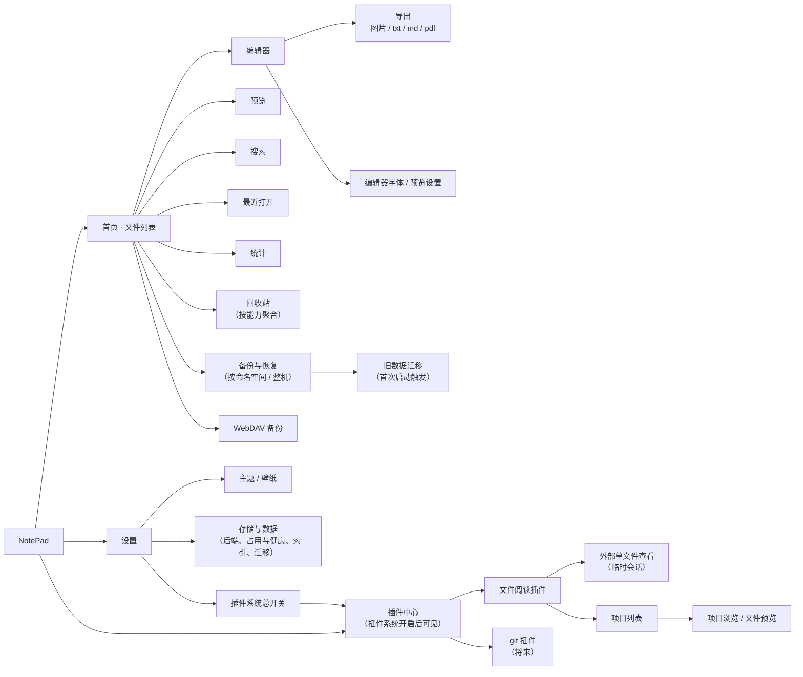
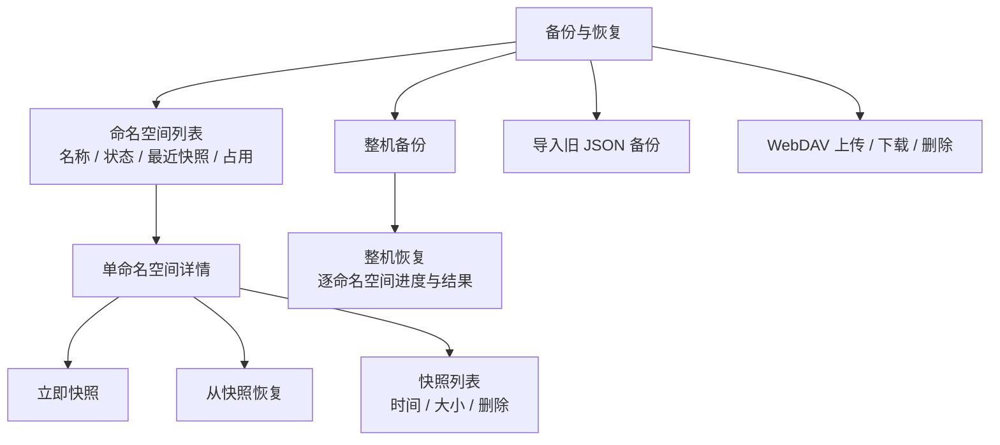
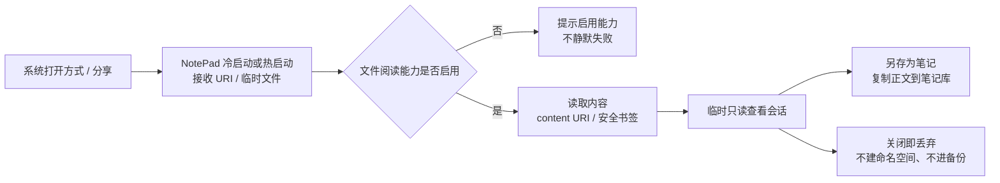
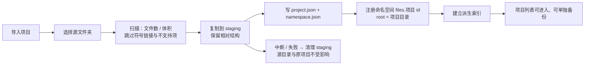

# NotePad 产品文档

> 版本：v1.0
> 状态：与《文件化改造方案（v2.1）》对齐
> 日期：2026-10-31
> 关联文档：[refactor-plan.md](./refactor-plan.md) · [architecture.md](./architecture.md)
> 适用工程：当前 Flutter 工程（Android / iOS 优先，桌面预研）

---

## 1. 产品定位

**一句话**：默认是一款「像文件管理器一样好用」的 Markdown 笔记软件；打开插件系统后，同一个应用逐步长成一个可装可卸能力的轻量 IDE。

- **默认形态 · 笔记软件**：对标「椒盐笔记」。零学习成本，打开即写，数据以纯文件（`.md`）落在设备上。
- **增强形态 · 多功能 IDE**：插件系统开启后，按需安装 git 克隆 / 推送、文件阅读 / 编辑等能力；笔记作为内置插件，可停用、可重装。
- **不变的前提**：正文永远只有文件一份，不存权威数据库；索引、缓存均为可重建的派生数据。

| 维度 | 结论 |
|---|---|
| 平台 | Flutter，Android / iOS 优先；桌面为预研，不在本期验收 |
| 数据形态 | 纯文件系统（Markdown + sidecar 元数据），无正文数据库 |
| 插件模型 | 声明式能力包 + 资源包，无第三方动态代码（D8） |
| 同步范围 | 本期只做单机 + 系统备份 + 手动 / WebDAV zip；真·iCloud Drive 同步不在本期（D1） |
| 回收站 / 备份 | 能力级策略，宿主提供机制与容器格式；每个命名空间在自己的路径下闭环（D5 / D11 / D12） |

---

## 2. 目标用户与场景

| 用户 | 典型场景 | 关键诉求 |
|---|---|---|
| 轻度记录者 | 便签、灵感、待办、日记 | 打开即写、自动保存、不丢数据 |
| Markdown 写作者 | 周报、长文、技术笔记 | 语法高亮、预览、导出、数学公式 / Mermaid |
| 知识库整理者 | 多层文件夹、大量文档、附件 | 树形管理、拖拽排序、搜索、批量移动 |
| 极客 / 开发者 | 在手机上读代码、管仓库 | 插件按需安装、可停用、数据不被插件绑架 |
| 跨端用户 | 换机、重装、误删 | 整机备份 / 单能力备份、可恢复的回收站 |

**核心用户旅程**：安装 → 新建第一篇 → 长期积累多层文档 → 误删后恢复 → 换机 / 重装后导入 → 打开插件系统按需扩展。

---

## 3. 两种产品形态

### 3.1 笔记形态（默认）

- 首屏即文件列表（根层级），底部 / 右下角为新建入口。
- 点开文章进入编辑器；返回列表保留当前层级与滚动位置。
- 设置中隐藏「插件中心」入口；不出现 IDE 相关概念（命名空间、备份包等对用户透明）。

### 3.2 IDE 形态（插件系统开启）

- 设置 → 打开「插件系统」后，出现「插件中心」，根界面切换为**工作台**（详见 [workbench.md](./workbench.md)）：
  活动栏 + 资源管理器 + 标签式编辑区 + 状态栏；`Ctrl/⌘+P` 转到文件、`Ctrl/⌘+Shift+P` 命令面板（窄屏为抽屉与底部弹层）。
- 资源管理器把所有启用能力的数据（笔记库、导入的项目……）放进同一棵树，笔记只是其中一个工作区文件夹。
- 插件可启停；笔记插件「卸载」= 停用能力，数据、注册表、回收站、备份全部保留，重装即恢复入口（D9）。
- 文件阅读能力有两种入口：**外部调用打开单个文件**（系统「打开方式 / 分享」，临时只读，不导入）与**按项目维度导入**（整目录复制为一个独立项目，单独备份 / 恢复）。
- 未来 git 等插件以独立命名空间接入，备份 / 回收站仍由宿主统一聚合展示。

---

## 4. 功能清单与优先级

> 优先级：P0 = 本期必须；P1 = 本期应做；P2 = 本期可延后 / 下期。
> 状态：`已有` = 当前工程已实现；`改造` = 本期在现有基础上调整；`新增` = 本期新建。

### 4.1 文档管理

| 功能 | 说明 | 优先级 | 状态 | 里程碑 |
|---|---|---|---|---|
| 多层级文件夹 | 文件夹与文章同树，无限嵌套 | P0 | 已有 | M0 |
| 新建文章 / 文件夹 | 当前层级内创建；文章创建后直接进入编辑器 | P0 | 已有 | M0 |
| 重命名 | 标题即文件名，改名同步磁盘（D3） | P0 | 已有 | M3 |
| 拖拽排序 | 同层内排序持久化，重启生效 | P0 | 已有 | M3 |
| 批量选择 / 移动 | 多选后可移动到任意文件夹 | P0 | 已有 | M3 |
| 层级导航 | 进入 / 返回上层，面包屑或标题回显 | P1 | 已有 | M3 |
| 外部变更对账 | 磁盘新增 / 删除 / 改名后刷新列表；前台恢复时触发 | P1 | 新增 | M3 |
| 定位当前编辑文章 | 从编辑器回到列表并高亮定位 | P2 | 已有 | M3 |

### 4.2 编辑与预览

| 功能 | 说明 | 优先级 | 状态 | 里程碑 |
|---|---|---|---|---|
| Markdown 编辑 | 纯文本编辑 + 实时语法高亮 | P0 | 已有 | M3 |
| 工具栏插入符号 | 快捷插入常用 Markdown 语法 | P1 | 已有 | M3 |
| 实时自动保存 | 编辑防抖落盘；文件实现采用原子写 | P0 | 已有 | M3 |
| 字数统计 | 中文字符 + 英文单词，实时显示 | P1 | 已有 | M3 |
| 撤销 / 重做 | 编辑器内操作历史 | P1 | 已有 | M3 |
| Markdown 预览 | 常见元素、代码高亮、HTML 开关 | P0 | 已有 | M3 |
| 数学公式 | MathJax 渲染（开关） | P1 | 已有 | M3 |
| Mermaid 图表 | 流程图渲染（开关） | P1 | 已有 | M3 |
| 图片显示 | 本地图片 / 网络图片缓存 | P1 | 已有 | M3 |
| 附件插入 UI | 图片 / 文件插入到 `assets/<noteId>/` | P2 | 新增 | M6（本期不做） |

### 4.3 检索与统计

| 功能 | 说明 | 优先级 | 状态 | 里程碑 |
|---|---|---|---|---|
| 关键词搜索 | 标题 + 正文匹配，结果可跳转 | P0 | 已有 | M3 |
| 最近打开 | 按最近编辑时间排序，可配置条数 | P1 | 已有 | M3 |
| 统计页 | 文章数、文件夹数、字数、存储占用 | P1 | 已有 | M3 |
| 全文索引（FTS） | 大库快速全文检索 | P2 | 新增 | M6 |

### 4.4 回收站

| 功能 | 说明 | 优先级 | 状态 | 里程碑 |
|---|---|---|---|---|
| 删除进回收站 | 目录 / 文章整棵子树搬运，保留原相对结构 | P0 | 已有（库内标记） | M3 |
| 恢复 | 还原到原位置；原位置被占用时自动加后缀 | P0 | 已有（库内标记） | M3 |
| 永久删除 / 清空 | 单项或全部清空，二次确认 | P0 | 已有 | M4 |
| 按能力分组 | 聚合视图：全部 / 单命名空间；停用能力条目带来源标签 | P1 | 新增 | M4 |
| 删除不可恢复提示 | 能力未提供 `TrashPolicy` 时明确警告，不做「假回收站」 | P1 | 新增 | M4 |
| 自动清理 | 超过保留期的回收站项自动清除（策略待定） | P2 | 新增 | 待确认 |

**语义**：插件卸载 ≠ 删数据。回收站内容在 `<nsRoot>/.notepad/trash/` 随命名空间一起保留，停用插件后宿主仍可恢复（D5 / D12）。

### 4.5 备份与恢复

| 功能 | 说明 | 优先级 | 状态 | 里程碑 |
|---|---|---|---|---|
| 单命名空间快照 | 生成 `<nsId>-<时间>.zip`，含 manifest + data | P0 | 新增 | M4 |
| 单命名空间恢复 | staging + 写锁 + 旧目录备份，失败回滚 | P0 | 新增 | M4 |
| 整机备份 | 每个命名空间一个子包 + 顶层 manifest | P1 | 新增 | M4 |
| 整机恢复 | 按命名空间顺序执行，逐项报告，不承诺全局原子 | P1 | 已有 | M4 |
| 本地备份目录 | 用户选择目录导出 zip | P1 | 改造（原 JSON） | M4 |
| WebDAV 备份 | 上传整机包到 `/NotePadBackup`，可列出 / 下载 / 删除 | P1 | 改造（原 JSON） | M4 |
| 自动备份 | 运行期周期备份（本地 / WebDAV 按配置） | P1 | 改造 | M4 |
| 旧 JSON 导入 | 仅作为导入格式，兼容 `format: 1` | P0 | 改造 | M2 / M4 |
| 备份保留策略 | 自动清理旧快照（数量 / 时间，具体值待定） | P2 | 新增 | 待确认 |

**硬约束**：
- 备份容器格式、manifest、sha256 由宿主定义（D12），任何命名空间即使插件停用也能被解读与恢复。
- 备份默认落在 `<appDataRoot>/namespaces/<nsId>/backups/`，不得落回 vault 内部（避免快照递归）。
- 恢复前必须静默写入并暂停后台任务（`quiesce`），恢复后重建索引（`afterRestore`）。

### 4.6 插件与能力

| 功能 | 说明 | 优先级 | 状态 | 里程碑 |
|---|---|---|---|---|
| 插件总开关 | 默认关闭，关闭时隐藏插件入口 | P1 | 已有 | M5 |
| 插件中心 | 已安装列表、启用 / 停用、下载安装 | P1 | 已有 | M5 |
| 声明式 manifest | id / name / version / capability / 资源，无动态代码 | P0 | 已有 | M5 |
| 插件启停 | 即时生效，无需重启 | P1 | 已有 | M5 |
| 卸载 = 停用 | 保留数据、注册表记录、回收站、备份；内置笔记 / 文件阅读同样可卸载 | P0 | 已有 | M5 |
| 工作台外壳 | 活动栏 / 侧栏 / 标签编辑区 / 状态栏；窄屏退化为抽屉 + 标签条 | P0 | 新增 | W3 |
| 命令与命令面板 | 所有操作都是命令；`>` 命令模式，无前缀按文件名快速打开 | P0 | 新增 | W1–W3 |
| 声明式贡献点 | manifest `contributes`：命令 / 菜单 / 视图 / 编辑器 / 状态栏；`run` 宏可组合宿主命令 | P0 | 新增 | W2 |
| 懒激活与停用释放 | `activationEvents`；停用即释放命令、文件系统、视图并关闭相关标签 | P0 | 新增 | W1–W2 |
| 重装 / 恢复入口 | 重新启用后入口与数据自动回来；笔记停用时首页改为能力入口页（保留备份 / 回收站 / 插件中心） | P0 | 已有 | M5 |
| 命名空间注册 | 插件声明 `namespace`，注册到 `registry.json` | P0 | 新增 | M5 |
| 彻底移除（forget） | 移除注册记录；需回收站为空 + 二次确认 | P2 | 新增 | M5 |
| 插件市场源 | 可配置 owner/repo | P2 | 已有 | M5 |

### 4.7 个性化与设置

| 功能 | 说明 | 优先级 | 状态 |
|---|---|---|---|
| 主题模式 | 跟随系统 / 浅色 / 深色 | P1 | 已有 |
| 壁纸 | 内置精选 + 本地相册自定义 | P1 | 已有 |
| 编辑器字体 / 字号 | 自定义字体族、字号、缩放、首行缩进 | P1 | 已有 |
| 预览开关 | HTML 解析、MathJax、Mermaid、字数显示 | P1 | 已有 |
| 启动页 | 文档列表 / 编辑器 | P2 | 已有 |
| 存储后端开关 | `sqlite` / `files` 灰度与回滚 | P0（内部） | 已有 |
| 数据占用与健康 | 各命名空间占用、索引重建、注册表状态 | P1 | 已有 |

### 4.8 文件阅读能力（builtin.files）

| 功能 | 说明 | 优先级 | 状态 | 里程碑 |
|---|---|---|---|---|
| 外部调用打开单文件 | 系统「打开方式 / 分享」把单个文件交给 NotePad，直接进入只读查看；**不导入、不建命名空间、不进备份 / 回收站** | P1 | 新增 | 待排期（依赖 M5 能力语义） |
| 应用内打开单文件 | 文件选择器选择单个文件，走同一套临时查看会话 | P1 | 已有 | 待排期 |
| 按项目维度导入 | 选择整个文件夹，复制为一个独立项目并注册为 `files.<projectId>` 命名空间 | P1 | 已有 | M5 |
| 项目列表 | 名称、文件数、大小、导入时间、状态（正常 / 缺失） | P1 | 已有 | M5 |
| 项目浏览 | 按原目录结构展示文件与子目录，支持逐层进入 | P1 | 已有 | M5 |
| 文件预览 | 文本 / Markdown 只读预览；二进制或超大文件明确提示不支持 | P1 | 已有 | M5 |
| 另存为笔记 | 将外部单文件正文复制进笔记库，生成 `.md` | P1 | 已有 | M5 |
| 项目更新 / 移除 | 重新导入同一来源可「更新项目」；移除前自动生成快照（若备份可用） | P2 | 已有 | M5 |
| 项目级备份 / 恢复 | 每个项目独立命名空间，单独快照与恢复（复用 M4 机制） | P1 | 已有 | M5 |
| 项目移除（无文件级回收站） | 不提供文件级删除；移除项目 = 快照后删除 + `forget`，`TrashPolicy = null` | P1 | 已有 | M5 |

**硬约束**

- 单文件会话是**临时态**：不写注册表、不写 tree、不进入备份 / 回收站；默认只读，编辑须显式「另存为笔记」。
- 项目导入本期默认**拷贝模式**（源目录不变）；外部引用（Android SAF / iOS 安全书签）不在本期，列入待确认 Q5。
- 每个项目一个命名空间，路径与笔记库隔离；文件阅读整体停用后，项目数据与快照仍可救援（D9 / D12）。

---

## 5. 信息架构

**导航规则**
- 首页为唯一常驻入口；各功能页为二级页面，通过顶部返回。
- 编辑器可从首页、搜索、最近打开三处进入，返回时回到来源页。
- 回收站 / 备份页内部按命名空间分组，默认展示「全部」。
- 插件中心仅在插件系统开启时出现；关闭后入口隐藏，已安装能力不执行。

---

## 6. 核心页面与交互

### 6.1 首页（文件列表）

| 区域 | 内容 | 交互 |
|---|---|---|
| 顶部栏 | 当前层级标题、返回、搜索、更多菜单 | 返回上层；搜索跳转；菜单含回收站 / 最近 / 统计 / 备份 / WebDAV / 设置 |
| 列表 | 文件夹与文章（名称、图标、修改时间 / 摘要） | 单击进入；长按进入多选；拖拽排序 |
| 多选栏 | 选中计数、移动、删除、全选 | 批量操作后退出多选 |
| 新建 | 新建文章 / 新建文件夹 | 文章创建后直接打开编辑器 |
| 空态 | 当前层级无内容 | 引导新建 |
| 错误态 | 读取失败（权限 / 损坏） | 显示原因 + 重试 |

**移动端要点**：拖拽排序在长列表中需可滚动；多选与拖拽不能同时激活；重命名使用底部弹层而非对话框（现有实现已如此）。

### 6.2 编辑器

- 进入即加载正文（懒加载，列表页不携带 body）。
- 输入后防抖自动保存；保存状态以「已保存 / 保存中 / 保存失败」轻提示呈现。
- 工具栏：Markdown 符号插入；顶部：返回、预览、更多（导出、重命名等）。
- 字数实时显示，可在设置关闭。
- 文件被外部修改（对账发现 mtime 变化）→ 提示「重新加载」或「保留当前」，**不静默覆盖**。

### 6.3 预览

- 覆盖常见 Markdown 元素、代码高亮、HTML（可关）、MathJax（可关）、Mermaid（可关）。
- 图片：本地 `assets/` 相对路径与网络图片；网络图片带缓存。
- 预览设置与编辑器设置分入口，避免主编辑界面被设置项挤占。

### 6.4 回收站（改造重点）

| 视图 | 内容 |
|---|---|
| 全部 | 所有命名空间条目，按删除时间倒序；每条带来源标签（如「笔记」） |
| 单能力 | 选定命名空间内的条目 |
| 条目 | 名称、原路径、删除时间、类型（文章 / 文件夹） |
| 操作 | 恢复、永久删除、清空（二次确认） |

- 停用插件的数据仍展示，标签显示为「已停用」样式，恢复入口可用。
- 恢复冲突：原路径已被占用 → 自动加 ` (2)`，并在结果中提示。

### 6.5 备份与恢复（改造重点）

- 快照过程展示进度（打包 → 校验 → 落盘），失败给出可读原因。
- 恢复前确认：覆盖范围、受影响文件数、不可撤销提示（旧目录会保留一份）。
- 恢复中断（杀进程 / 断网）后重进：检测 staging 与 journal，提示继续或清理。

### 6.6 插件中心

- 列表：图标、名称、版本、作者、能力说明、启用开关、卸载 / 重装。
- 内置笔记：显示「内置」，可停用；卸载动作文案为「停用并保留数据」。
- 外部插件：安装（zip）、启用 / 停用、卸载；卸载同样保留其命名空间数据。
- 停用确认弹窗明确写出：**数据不会删除，可在备份 / 回收站中继续访问**。

### 6.7 迁移页（首次升级触发）

- 触发条件：存在旧 `app_database.db` 且迁移未成功。
- 展示：待迁移节点数、预估耗时、冲突项（重名 / 超长 / 非法字符）。
- 动作：开始迁移 / 稍后（稍后每次启动再次提示）/ 查看详情。
- 结果：成功（节点数、耗时）/ 失败（原因 + 回滚说明，旧库保留）。
- 迁移完成后旧库改名留档，不删除。

### 6.8 文件阅读页

| 区域 | 内容 | 交互 |
|---|---|---|
| 顶部 | 标题「文件阅读」、项目入口、打开文件 | 打开单文件 / 导入项目 |
| 项目列表 | 项目名、文件数、大小、导入时间、状态标签 | 进入项目；长按更新 / 移除 |
| 项目浏览 | 目录树或层级列表，文件图标、大小、修改时间 | 逐层进入；点击文件预览 |
| 单文件查看 | 文件名、来源标签「外部文件」、只读正文 | 返回；另存为笔记 |
| 空态 | 尚无项目 | 引导导入项目 / 打开文件 |
| 缺失态 | 项目根不可用 | 灰态 + 「重新定位 / 移除记录」 |

- 文件阅读能力停用后入口隐藏；被系统外部调用时提示「文件阅读能力已停用，是否启用」，不静默失败。
- 项目预览与笔记预览共用渲染器，但**不共用编辑与自动保存**：项目内文件默认只读。

### 6.9 数据占用与健康

| 区域 | 内容 | 交互 |
|---|---|---|
| 汇总 | 数据占用、备份占用、命名空间数量 | — |
| 命名空间卡片 | 名称、状态（正常 / 已停用 / 缺失）、插件、数据占用、快照数量与最近时间、回收站驱动、根目录 | 根目录不可用时标红显示原因 |
| 恢复残留 | 上次恢复中断留下的 staging 目录与占用 | 「清理」二次确认后删除 |
| 维护 | 重建笔记索引、跳转备份和恢复 | 重建只重扫磁盘，不改内容 |

---

## 7. 核心用户流程

### 7.1 新建并编辑一篇笔记

### 7.2 删除与恢复

### 7.3 换机 / 重装恢复

### 7.4 停用笔记插件后仍可救援数据

### 7.5 外部调用打开单个文件

### 7.6 按项目维度导入

---

## 8. 状态与异常设计

### 8.1 通用页面状态

| 状态 | 表现 | 退出条件 |
|---|---|---|
| 加载中 | 骨架 / 进度指示，不阻塞返回 | 数据返回或失败 |
| 空 | 图标 + 一句引导 + 主操作 | 产生数据 |
| 错误 | 原因文案 + 重试按钮；日志写入本机 | 重试成功 |
| 部分成功 | 列表逐项标注成功 / 失败，可重试失败项 | 用户处理 |
| 离线 / 未配置 | WebDAV 未配置时禁用上传入口并提示配置 | 配置完成 |

### 8.2 关键异常

| 场景 | 处理 |
|---|---|
| 磁盘满 / 写入失败 | 编辑器保留内存内容，显性提示「保存失败」，禁止显示已保存 |
| 权限丢失（外部目录） | 提示重新授权，只读降级，禁止静默丢写 |
| 文件名非法 / 超长 / 重名 | 按 `FilenamePolicy` 清洗 / 截断 / 加后缀，并在重命名结果中告知实际名称 |
| tree.json 损坏 | 全盘扫描重建，顺序按自然排序，记录 `rebuilt: true`，UI 提示「顺序可能变化」 |
| 外部改名 | 视为删 + 增，不追踪指纹；列表刷新后呈现新名字 |
| 外部删除正在编辑的文件 | 保存前检测存在性，提示「文件已被删除，另存为新文件 / 放弃」 |
| 恢复快照校验失败 | 拒绝恢复，保留现有数据，提示备份包损坏 |
| 恢复中断 | 启动检测 staging + journal，提示继续或清理，不自动覆盖 |
| 停用插件 | 入口隐藏，数据入口保留在备份 / 回收站，标签标注「已停用」 |
| 注册表记录指向不存在的根 | `state=missing`，UI 灰态，提供「移除记录（需回收站为空）」 |
| 外部文件被移动 / 删除 | 查看页提示「文件已不可用」，仅保留只读缓存快照，不写回笔记库 |
| 外部 URI 权限失效 | 提示重新选择文件或重新授权；不清空已有笔记数据 |
| 二进制 / 超大文件 | 明确提示「暂不支持预览」或「文件过大」，不一次性载入内存 |
| 项目重复导入 | 提示「更新现有项目 / 另存为新项目」，不静默覆盖 |
| 项目导入中断 | staging 残留，重进提示继续或清理；原项目与源目录不受影响 |
| 项目根不可用 | `state=missing`，项目灰态，可重新定位或移除记录 |

### 8.3 文案原则

- 说清「发生了什么 + 影响范围 + 下一步」，不用技术术语（不向普通用户暴露「命名空间」「manifest」）。
- 破坏性操作必须写清「可恢复 / 不可恢复」；不可恢复时才用红色主按钮。
- 后台失败不打断写作，但必须在页面内留下可发现的提示。

---

## 9. 非功能需求

| 类别 | 要求 |
|---|---|
| 可靠性 | 正文写入必须原子（tmp + rename）；任何崩溃后不得出现半写文件；迁移 / 恢复失败可回滚 |
| 数据安全 | 删除默认进回收站；备份默认开启手动可用；旧库迁移后保留原文件 |
| 性能 | 10k 文件单层列表 < 200ms（目标值，基准校准）；启动到可交互不因索引阻塞；编辑输入无卡顿 |
| 内存 | 列表不加载正文；大文档按需读取；图片走缓存 |
| 兼容 | iOS / Android 路径与备份语义一致；文件名跨端一致（NFC + 大小写不敏感去重） |
| 可维护 | UI 只依赖 `NotesRepository`；能力只通过 `StorageCapability` 接入备份 / 回收站 |
| 可测试 | sqlite 与文件实现共用一套契约测试；驱动策略分支全部覆盖 |
| 隐私 | 数据默认仅本机；WebDAV 凭据仅存本机偏好；不上传任何遥测 |
| 无障碍 | 主要操作有语义标签；字号可调；深浅色对比达标 |

---

## 10. 验收标准

### 10.1 里程碑验收

| 里程碑 | 验收标准 |
|---|---|
| M0 接缝 | 用户可见行为零变化；`NoteProvider` 注入 repository；契约测试以现有 DAO 行为为基线全绿；`flutter analyze` 无新增告警 |
| M1 内核 | 双实现契约测试全绿；重名 / emoji / 超长 / 大小写冲突 / 崩溃残留 / tree 损坏重建 / 外部对账 / 回收站搬运 / 单命名空间快照恢复全部通过；`NamespaceHandle` 越界必须失败；10k 单层列表 < 200ms |
| M2 迁移 | fixture（嵌套 / 回收站 / 重名 / 空标题 / emoji）迁移后文件树与 tree.json 完全对应；重复执行幂等；磁盘满 / 权限失败可回滚；旧库保留 |
| M3 UI | 手工矩阵（新建 / 改名 / 移动 / 拖拽 / 搜索 / 回收站 / 杀进程重开）通过；现有 widget 测试通过；外部改动提示生效 |
| M4 备份 / 回收站 | 快照 → 改数据 → 恢复成功；恢复中途被杀可重入；hash 失败被拒绝；停用笔记后仍能查看并恢复其 trash / backup；按能力分组正确 |
| M5 插件语义 | 停用笔记后数据零变化、入口隐藏、备份 / 回收站可用；重装入口恢复；`forget` 需回收站为空 + 二次确认 |
| 文件阅读（待排期） | 外部单文件可直接打开且不产生命名空间；项目导入后目录结构与源一致，可单独备份 / 恢复；停用能力后项目数据与快照仍可救援 |

### 10.2 用户验收场景（UAT）

1. 新用户首次打开 → 新建文章 → 输入 → 杀进程 → 重开内容完整。
2. 建三层文件夹 → 拖拽排序 → 重启顺序不变。
3. 删除含子文档的文件夹 → 回收站可见整棵树 → 恢复后层级与顺序一致。
4. 与文件 App / 电脑互传：外部新增 md → 应用刷新后出现；外部删除 → 列表中消失或灰态。
5. 手动整机备份 → 卸载重装应用 → 导入备份 → 全部命名空间恢复。
6. 打开插件系统 → 停用笔记 → 数据仍在备份 / 回收站 → 重新启用后一切回来。
7. 迁移旧库 → 文章数、层级、回收站数量与旧版一致；旧库文件仍存在。
8. 从系统文件 App「打开方式」选择 NotePad 打开单文件 → 立即可读；笔记库无新增；「另存为笔记」后出现新文章。
9. 导入含多级子目录的项目 → 项目内结构与源一致；笔记首页不受影响；对项目单独快照 / 恢复成功。
10. 停用文件阅读插件 → 项目入口隐藏，备份仍可恢复；重新启用后项目与列表回来。

---

## 11. 范围外（本期不做）

- 真·iCloud Drive 实时同步与冲突合并（D1）。
- git 插件、文件编辑能力的实际实现；文件阅读本期只定义入口与命名空间语义，实现待排期。
- 外部项目引用模式（Android SAF / iOS 安全书签）与项目内文件编辑回写。
- 全文索引 FTS、附件插入 UI、端到端加密、多人协作。
- 桌面端正式支持（仅保持代码可移植，不做验收）。
- 插件市场服务端、插件签名与审核体系。

---

## 12. 待确认问题

| # | 问题 | 影响 | 建议 |
|---|---|---|---|
| Q1 | 自动备份与快照保留策略（保留份数 / 天数） | 存储占用与用户预期 | 默认保留最近 N 份 + 可配置，需产品确认 N |
| Q2 | 回收站自动清理是否本期提供 | 磁盘占用 | 建议下期，先提供手动清空 |
| Q3 | 恢复时旧目录保留份数 | 磁盘占用 | 建议仅保留最近 1 份，超出提示 |
| Q4 | 停用插件的入口呈现（完全隐藏 vs 设置内可见） | 可发现性 | 建议入口隐藏、备份 / 回收站保留来源标签 |
| Q5 | 项目导入采用拷贝还是外部引用（SAF / 安全书签） | 存储占用、源目录实时性、权限复杂度 | 本期建议拷贝（源目录不变）；引用模式下期单独立项 |
| Q6 | 外部单文件是否允许编辑回写原文件 | 数据安全与体验 | 本期建议只读 + 「另存为笔记」；回写需明确确认与冲突策略 |

